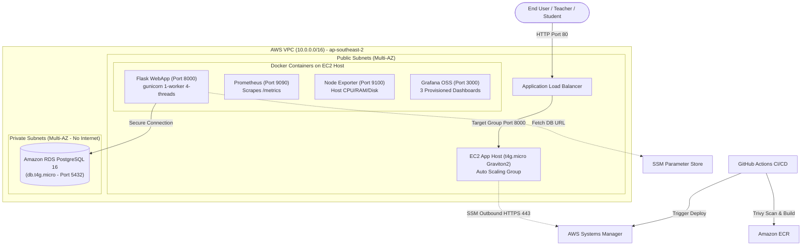

# Student Marks & Performance Portal (AWS DevOps Capstone)

[](https://github.com/amisha-sam/student-portal/actions/workflows/app-ci.yml)
[](https://www.terraform.io/)
[](https://aws.amazon.com/)
[](https://www.docker.com/)
[](https://www.python.org/)
[](https://www.postgresql.org/)
[](https://prometheus.io/)

A production-grade, cost-optimized **Student Marks & Academic Performance Portal** deployed on AWS using a modern DevOps toolchain. Designed to solve manual marks calculation, automate grade generation, and provide early intervention through an automated **"Needs Support" (At-Risk)** detection engine.

---

## Architecture Diagram



---

## DevOps Practice & Toolchain Matrix

| Area | Solution | Key Highlights & Design Decisions |
|---|---|---|
| **Infrastructure as Code** | **Terraform >= 1.10** | Modular architecture (`vpc`, `security`, `ecr`, `iam`, `rds`, `compute`, `alb`). S3 backend with native state locking (`use_lockfile = true`) — **no DynamoDB needed**. |
| **Configuration Management** | **Ansible via AWS SSM** | Idempotent Ansible roles (`docker`, `swap`, `node_exporter`, `prometheus`, `grafana`, `app`) executed over AWS SSM Run Command. **Zero open SSH ports (Port 22 closed)**. |
| **CI/CD Automation** | **GitHub Actions** | Automated linting (`flake8`), unit tests (`pytest` with coverage), Dockerfile linting (`hadolint`), container security scanning (**Aqua Security Trivy**), ECR push, and zero-downtime SSM deployment. |
| **Monitoring & Observability** | **Prometheus + Grafana** | Automated collection of system, application, and business metrics. 3 provisioned dashboards as code (**Academic Performance**, Application Metrics, Infrastructure). Automated alert rules (`AppDown`, `High5xxErrorRate`, `HighCpuUsage`, `ElevatedAcademicRiskCohort`). |
| **Security & Secrets** | **SSM Parameter Store** | KMS-encrypted `SecureString` for database passwords and connection URLs. Defense-in-depth security groups. Enforced IMDSv2. Encrypted EBS and RDS storage. |
| **Cost Optimization** | **Zero-Waste AWS Design** | **No NAT Gateway** (saved ~$32.40/mo), Free-Tier Graviton2 (`t4g.micro`), free SSM Parameter Store (saved $0.80/mo vs Secrets Manager), ECR lifecycle cleanup, and one-command teardown script. |

---

## Application Features

1. **Role-Based Access Control (RBAC):**
   - `admin` & `teacher`: Full marks entry, student management, class overview, at-risk interventions, and CSV exports.
   - `student`: Strictly restricted to viewing and downloading their own academic report card.
2. **Automated At-Risk Detection ("Needs Support"):**
   - Automatically flags students when **any subject average < 40%** or **overall average < 50%**.
   - Displays exact, transparent intervention reasons (e.g. *"Maths: 29% (below 40%); Overall 35% (below 50%)"*).
3. **Official PDF Report Card Generation:**
   - ReportLab-powered, publication-grade academic transcripts available at `/report/<id>.pdf`.
4. **CSV Class Summary Export:**
   - Instant export of student performance summaries for administrative records.
5. **Prometheus Metrics Endpoint:**
   - Custom counters and gauges (`students_total`, `students_at_risk{class_name}`, `class_average{class_name}`, `marks_entries_total`, `http_requests_total`).

---

## Quickstart

### 1. Local Development (Docker Compose)
```bash
git clone https://github.com/amisha-sam/student-portal.git
cd student-portal

# Start local app and PostgreSQL database
docker compose -f docker/docker-compose.yml up --build -d

# Seed demo users and marks
docker compose -f docker/docker-compose.yml exec app flask --app app seed
```
- Open `http://localhost:8000`
- **Demo Logins:**
  - Teacher: `teacher` / `teacher123`
  - Admin: `admin` / `admin123`
  - Student: `R001` / `student123`

### 2. Run Local Unit Tests
```bash
pytest app/tests/ -v
```

---

## AWS Cloud Deployment

### Prerequisites
- AWS CLI configured with profile `studentportalnew` (Region: `ap-southeast-2`)
- Terraform >= 1.10
- Docker Desktop with buildx support

### Deploy Everything in One Command
```bash
./scripts/startup.sh
```
This script automatically:
1. Applies Terraform infrastructure in `terraform/envs/dev`
2. Builds the ARM64 Docker container image and pushes it to Amazon ECR
3. Packages Ansible roles and deploys them to the EC2 host via AWS Systems Manager
4. Verifies the live Application Load Balancer health check

### Teardown (Conserve AWS Credits)
```bash
./scripts/teardown.sh
```

---

## Live Endpoints

- **Public Application:** `http://student-portal-dev-alb-2065164625.ap-southeast-2.elb.amazonaws.com`
- **Health Check:** `http://student-portal-dev-alb-2065164625.ap-southeast-2.elb.amazonaws.com/health`
- **Prometheus Scrape Endpoint:** `http://student-portal-dev-alb-2065164625.ap-southeast-2.elb.amazonaws.com/metrics`
- **At-Risk Interventions:** `http://student-portal-dev-alb-2065164625.ap-southeast-2.elb.amazonaws.com/at-risk`

---

## Documentation

- **[Operations Runbook](docs/runbook.md):** Deployment, rollback procedures, common failure resolutions, and OOM protection.
- **[Cost Analysis & Free Tier Guide](docs/cost.md):** Detailed resource pricing table, architectural savings, and free-plan alignment.
- **[Viva Defense & Jury Guide](docs/viva.md):** Architectural decisions, trade-off comparisons, and 10-minute live demo script.
