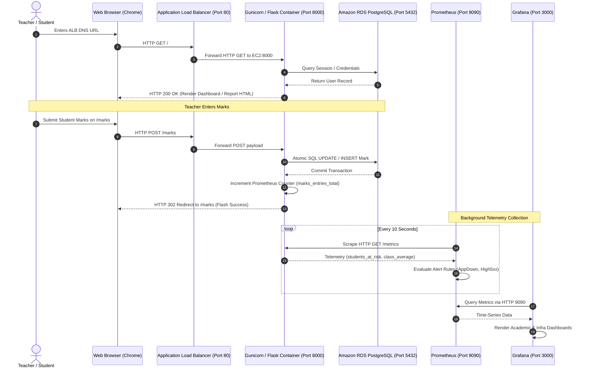
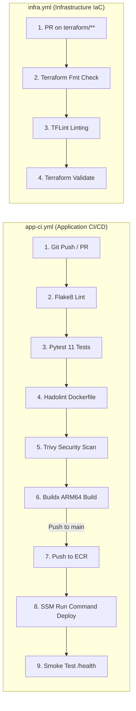

# Student Marks & Performance Portal — AWS DevOps Capstone Master Guide

> **Author / Student Presenter:** Amisha Sam  
> **Degree / Program:** AWS Cloud DevOps Capstone  
> **AWS Account ID:** `149168123176` | **Region:** `ap-southeast-2` (Sydney)  
> **CLI Profile:** `studentportalnew`  
> **Live Production URL:** [`http://student-portal-dev-alb-2065164625.ap-southeast-2.elb.amazonaws.com`](http://student-portal-dev-alb-2065164625.ap-southeast-2.elb.amazonaws.com)  
> **GitHub Repository:** [`https://github.com/amisha-sam/student-portal`](https://github.com/amisha-sam/student-portal)

---

## Table of Contents
1. [Complete Project Understanding](#1-complete-project-understanding)
2. [Complete Technology Stack (AWS & Non-AWS)](#2-complete-technology-stack)
3. [Complete AWS Services Explanation](#3-complete-aws-services-explanation)
4. [Non-AWS Tools & Supporting Technologies](#4-non-aws-tools-and-supporting-technologies)
5. [Complete Application Architecture & Request Lifecycle](#5-complete-application-architecture)
6. [Database and Data Storage Deep Dive](#6-database-and-data-storage)
7. [Docker and Containerisation Deep Dive](#7-docker-and-containerisation)
8. [CI/CD Pipelines and Automation](#8-cicd-pipelines-and-automation)
9. [Networking and Security Architecture](#9-networking-and-security)
10. [Monitoring, Alerting, and Observability](#10-monitoring-alerting-and-observability)
11. [Chronological Project Build History](#11-chronological-project-build-history)
12. [Tomorrow's Pre-Flight & Laptop Restart Guide](#12-tomorrows-pre-flight-guide)
13. [Step-by-Step 10-Minute Jury Demonstration Script](#13-step-by-step-jury-demonstration-script)
14. [Comprehensive Jury Q&A Defense](#14-comprehensive-jury-qa-defense)
15. [Final Project Verification Checklist](#15-final-project-verification-checklist)

---

## 1. Complete Project Understanding

### What is our project?
The **Student Marks & Academic Performance Portal** is a production-grade, containerised web platform hosted on Amazon Web Services (AWS). It is designed to modernize academic record management by automatically recording subject marks, calculating semester grades, generating official PDF transcripts, and surfacing early interventions for struggling students through an automated **"Needs Support" (At-Risk)** detection engine.

### What problem does it solve?
In secondary schools and colleges, academic mark calculations are typically recorded in paper registers or disconnected spreadsheets. This manual workflow creates three major pain points:
1. **Human Error:** Calculating weighted subject averages and cumulative percentage grades by hand leads to computational discrepancies.
2. **Delayed Intervention:** Teachers only realize a student is failing at the end of the term when final report cards are compiled. By then, it is too late to offer remedial classes.
3. **Data Inaccessibility:** Students and parents must wait weeks for printed transcripts, with no self-service access to historical academic progress.

### Why did we choose this project?
This project demonstrates solving a tangible real-world problem while exercising the **entire AWS DevOps lifecycle**:
- **Infrastructure as Code (IaC):** 100% of the AWS infrastructure is written in modular Terraform 1.10+.
- **Zero-SSH Configuration Management:** Virtual machines are provisioned through Ansible orchestrated entirely over AWS Systems Manager (SSM) with Port 22 closed.
- **Security & Quality Gates:** Automated CI/CD pipelines in GitHub Actions enforce code formatting (`flake8`), unit tests (`pytest`), container linting (`hadolint`), and vulnerability scanning (**Aqua Security Trivy**).
- **Modern Observability:** Multi-tier monitoring using Prometheus, Node Exporter, and Grafana with pre-provisioned dashboards.
- **Cost Engineering:** Engineered specifically for a free-tier/credit-limited AWS account ($0/month by omitting expensive NAT Gateways and DynamoDB tables).

### Who are the intended users?
The portal implements strict **Role-Based Access Control (RBAC)** for three distinct personas:
1. **Administrators (`admin`):** Full system oversight, student and subject management, and global data export.
2. **Teachers (`teacher`):** Marks entry per class and subject, real-time analytics access, and immediate intervention monitoring on the "Needs Support" dashboard.
3. **Students (`student`, username = Roll Number, e.g., `R001`):** Self-service read-only access strictly isolated to their own performance reports and downloadable PDF transcripts.

### What are its main features?
- **Interactive Dashboard:** Aggregated Key Performance Indicators (Total Students, Cohort Average, Total At-Risk Count) paired with live **Chart.js** visualizations showing grade distribution and subject averages.
- **Bulk Marks Entry (`/marks`):** Class and subject-based entry form with dynamic range validation ($0 \le \text{score} \le 100$) and atomic database upserts.
- **"Needs Support" (At-Risk) Engine (`/at-risk`):** Automatic cohort flagging with transparent intervention reasons (e.g., *"Maths: 29% (below 40%); Overall 35% (below 50%)"*).
- **Dynamic PDF Report Cards (`/report/<id>.pdf`):** ReportLab-powered official transcripts containing student metadata, subject marks table, status badges, and academic intervention notices.
- **CSV Data Export (`/export.csv`):** One-click administrative spreadsheet export.
- **Prometheus Metrics Engine (`/metrics`):** Real-time application and business telemetry exposed for Prometheus scraping.

### What happens from the moment a user opens the website until they finish?
1. **DNS Resolution & Ingress:** The user inputs the Application Load Balancer DNS name into Google Chrome. AWS Route 53 and Internet Gateways direct the traffic to the ALB in `ap-southeast-2`.
2. **Load Balancing:** The ALB terminates the external HTTP connection on Port 80 and forwards the request across the public subnet to Port 8000 on the active EC2 instance running in an Auto Scaling Group.
3. **Container Processing:** Inside the EC2 host, the **Gunicorn** WSGI application server receives the request and delegates it to the Flask application.
4. **Authentication & Session:**
   - Unauthenticated users are redirected to `/login`.
   - The user submits their credentials (`username`, `password`).
   - Flask validates the bcrypt hash stored in the **Amazon RDS PostgreSQL 16** database.
   - Upon successful verification, Flask-Login generates an encrypted, secure session cookie.
5. **Dashboard Rendering:**
   - If a teacher logs in, Flask queries PostgreSQL for all student marks, computes cohort averages, renders `dashboard.html` with Jinja2, and serves Chart.js graphs via asynchronous calls to `/api/charts`.
   - If student `R001` logs in, the application inspects the role and redirects directly to `/report/1`.
6. **Data Mutation & Telemetry:** When a teacher submits marks on `/marks`, SQLAlchemy persists the data to RDS PostgreSQL inside the private subnet, increments the Prometheus counter `marks_entries_total`, and recalculates real-time class gauges.
7. **Logout:** The user clicks Logout; Flask destroys the server-side session and clears the browser cookie.

---

## 2. Complete Technology Stack

| Technology | Category | Where Used | Why Chosen & Role in Project | What Happens If Removed |
|---|---|---|---|---|
| **Python 3.12** | Programming Language | Backend Application | Clean syntax, high reliability, native support for modern typing and async tooling. | The entire backend logic stops executing. |
| **Flask 3.1** | Web Framework | Backend Routing & MVC | Extremely lightweight (<100MB RAM footprint), modular, fast startup time on micro cloud instances. | No HTTP routing, request handling, or template rendering. |
| **Flask-SQLAlchemy 3.1** | ORM (Object-Relational Mapping) | Database Abstraction | Bridges Python classes (`User`, `Student`, `Mark`) to PostgreSQL relational tables with SQL injection protection. | Developers would need to write raw, error-prone SQL strings manually. |
| **SQLAlchemy 2.0.36** | Core DB Engine | Database Driver Integration | **Pinned specifically to 2.0.36** to guarantee stable PostgreSQL dialect integration with `psycopg2-binary`. | Newer unpinned releases attempt to load `psycopg` v3, causing startup crashes. |
| **psycopg2-binary 2.9.9** | Database Driver | PostgreSQL Connectivity | C-optimized, rock-solid PostgreSQL adapter for Python. | Python cannot establish TCP socket connections to PostgreSQL. |
| **Flask-Login 0.6** | Authentication | Session Management | Manages user sessions, login state, cookie encryption, and `@login_required` decorators. | No user authentication; all endpoints would either be public or crash. |
| **Werkzeug 3.1** | Security / Utilities | Password Hashing | Secure cryptographic password hashing (`generate_password_hash`, `check_password_hash`) using PBKDF2/SHA256. | Passwords would be stored in plaintext (critical security vulnerability). |
| **ReportLab 4.2** | Document Engine | PDF Report Cards | Low-level, high-fidelity PDF canvas generation for official academic report cards. | The `/report/<id>.pdf` endpoint fails; no printable report cards. |
| **prometheus_client 0.21** | Observability Library | Telemetry Generation | Exposes custom business and application metrics (`students_at_risk`, `class_average`) on `/metrics`. | Prometheus cannot scrape application KPIs; Grafana academic dashboard goes blank. |
| **Gunicorn 23.0** | WSGI Server | Production Web Server | Production-ready HTTP server running with **1 worker and 4 threads** to maintain Prometheus counter consistency. | Flask would run in development server mode (unsafe, single-threaded, slow). |
| **Bootstrap 5.3** | Frontend CSS Framework | Responsive Layout | Clean, modern UI components, flexbox grids, and responsive styling for mobile and desktop screens. | UI reverts to unstyled raw HTML with broken layouts. |
| **Chart.js 4.4** | Frontend Data Visualization | Dashboard Visuals | High-performance, client-side HTML5 canvas charting for grade distribution and subject averages. | Dashboard shows only raw numbers without visual analytical charts. |
| **Bootstrap Icons 1.11** | Icon Library | UI Enhancements | Modern iconography for navigation tabs, status badges, and alert markers. | UI lacks visual cues and alert iconography. |

---

## 3. Complete AWS Services Explanation

Every AWS service listed below is **actively configured, deployed, and operating** in account `149168123176` (Region: `ap-southeast-2`):

```
                                  +------------------------------------+
                                  |     AWS Route 53 / Internet        |
                                  +-----------------+------------------+
                                                    |
                                                    v
                                  +-----------------+------------------+
                                  |   Application Load Balancer (ALB)  |
                                  |         (Public Subnets)           |
                                  +-----------------+------------------+
                                                    | Port 8000
                                                    v
+-------------------------------+ +-----------------+------------------+
|      AWS Systems Manager      | |     EC2 Host (t4g.micro Graviton2) |
|  - Parameter Store (Secrets)  |<|  - Auto Scaling Group              |
|  - Run Command (Zero-SSH)     | |  - Docker Engine                   |
|  - Session Manager (Console)  | |    * App (8000)   * Prom (9090)    |
+-------------------------------+ |    * Grafana(3000)* NodeExp (9100) |
                                  +-----------------+------------------+
                                                    | Port 5432
                                                    v
                                  +-----------------+------------------+
                                  |     Amazon RDS PostgreSQL 16       |
                                  |        (Private Subnets)           |
                                  +------------------------------------+
```

### 1. Amazon Virtual Private Cloud (VPC)
- **What it does:** Provisions a logically isolated virtual network dedicated to our project.
- **Why selected:** Provides complete control over IP addressing, subnets, route tables, and network security.
- **Configuration:** CIDR block `10.0.0.0/16` divided into 4 subnets across two Availability Zones (`ap-southeast-2a`, `ap-southeast-2b`):
  - Public Subnet 1 (`10.0.1.0/24`) & Public Subnet 2 (`10.0.2.0/24`)
  - Private Subnet 1 (`10.0.10.0/24`) & Private Subnet 2 (`10.0.11.0/24`)
- **Key Design Decision:** **Zero NAT Gateways**. Saves ~$32.40/month. App instances reside in public subnets with tight security groups, while RDS resides in private subnets with no internet access.

### 2. Application Load Balancer (ALB)
- **What it does:** Distributes incoming HTTP traffic across compute targets and provides a single stable DNS entrypoint.
- **Why selected:** High availability, automated health checks, seamless integration with Auto Scaling Groups.
- **Configuration:** Internet-facing ALB (`student-portal-dev-alb`) listening on Port 80. Routes traffic to Target Group (`student-portal-dev-tg`) checking `/health` every 15 seconds.
- **Resource Name:** `student-portal-dev-alb-2065164625.ap-southeast-2.elb.amazonaws.com`

### 3. Amazon EC2 & Auto Scaling Group (ASG)
- **What it does:** Provides scalable, self-healing compute capacity.
- **Why selected:** Self-heals if the virtual server crashes; matches free-tier Graviton2 benefits.
- **Configuration:** Launch Template (`student-portal-dev-lt-*`) running **Amazon Linux 2023 ARM64** on a `t4g.micro` instance (2 vCPU, 1 GB RAM). ASG configured with `min=1, max=1, desired=1` and an extended health-check grace period of 900 seconds.
- **Resource Name:** ASG `student-portal-dev-asg-20261102125351283000000007`

### 4. Amazon Relational Database Service (RDS)
- **What it does:** Managed relational database engine handling provisioning, patching, OS maintenance, and automated backups.
- **Why selected:** Offloads database administration and isolates data in private subnets.
- **Configuration:** PostgreSQL Engine version `16.11` on instance class `db.t4g.micro` with 20 GB gp3 storage. Multi-AZ is disabled for cost optimization. Storage encryption enabled via AWS KMS.
- **Resource Endpoint:** `student-portal-dev-db.c3qwqga6eda8.ap-southeast-2.rds.amazonaws.com:5432`

### 5. Amazon Elastic Container Registry (ECR)
- **What it does:** High-performance, private Docker container registry.
- **Why selected:** Secure, in-region container image hosting with IAM-governed access.
- **Configuration:** Repository `student-portal-dev-app` with image scanning on push and automated lifecycle cleanup (expires untagged images >1 day; retains only the last 3 tagged images).
- **Resource URI:** `149168123176.dkr.ecr.ap-southeast-2.amazonaws.com/student-portal-dev-app`

### 6. AWS Systems Manager (SSM)
- **What it does:** Provides secure instance management, parameter storage, and command execution without SSH.
- **Components Used:**
  1. **SSM Parameter Store:** Stores the database connection string as a `SecureString` (`/student-portal/dev/database_url`) encrypted with AWS KMS. Free of charge (saved $0.80/month vs AWS Secrets Manager).
  2. **SSM Run Command:** Executes our Ansible deployment playbook locally on the host without open inbound ports.
  3. **SSM Session Manager:** Allows terminal access for debugging without Port 22 or SSH keys.

### 7. AWS Identity and Access Management (IAM)
- **What it does:** Controls authentication and authorization for AWS resources.
- **Configuration:** EC2 Instance Role `student-portal-dev-ec2-role` with `AmazonSSMManagedInstanceCore` and a least-privilege policy allowing ECR image pulls and SSM Parameter Store reads on `/student-portal/dev/*`.

### 8. Amazon S3 (Simple Storage Service)
- **What it does:** Highly durable object storage.
- **Why selected:** Holds the remote Terraform state file.
- **Configuration:** Versioned, encrypted, public-access-blocked bucket `student-portal-tfstate-149168123176` utilizing Terraform 1.10+ native lockfiles (`use_lockfile = true`), eliminating DynamoDB table costs.

### AWS Services Considered but Deliberately Omitted
1. **NAT Gateway:** Omitted to prevent $32.40/month continuous charges.
2. **DynamoDB:** Omitted for state locking because Terraform 1.10+ native S3 lockfiles replaced it at zero cost.
3. **AWS Secrets Manager:** Omitted in favor of SSM Parameter Store SecureString, saving $0.40 per secret per month.
4. **AWS Elastic Kubernetes Service (EKS) / ECS:** Omitted because running a Kubernetes control plane costs $72.00/month, which would immediately deplete student credits. Docker on EC2 delivers complete containerisation at $0.00.
5. **IAM OpenID Connect (OIDC) Provider:** Probed during pre-flight, but discovered that the account's parent organisation has an explicit Service Control Policy (`p-nzqi9r7t`) denying `iam:*OpenIDConnectProvider*`. We engineered around this by using encrypted GitHub Secrets.

---

## 4. Non-AWS Tools and Supporting Technologies

- **Docker:** Packages our application code, system libraries, and runtime dependencies into lightweight, immutable container images.
- **Docker Compose:** Orchestrates local multi-container development (PostgreSQL DB + Flask App) via [docker/docker-compose.yml](file:///Users/amishasamk.j/Downloads/student-portal/docker/docker-compose.yml).
- **Terraform (HashiCorp):** Declarative Infrastructure as Code engine that manages the entire lifecycle of all 33 AWS resources.
- **Ansible:** Agentless configuration management engine. Used to configure swap memory, install Docker, provision Prometheus and Grafana dashboards, and execute database seeding.
- **Git & GitHub:** Distributed version control and collaboration platform hosting our codebase at `amisha-sam/student-portal`.
- **GitHub Actions:** Cloud-native CI/CD automation runner executing tests, linting, security scans, and deployment pipelines.
- **Hadolint:** Specialized linter for Dockerfiles to enforce container best practices.
- **Aqua Security Trivy:** Comprehensive vulnerability scanner that inspects our container image OS packages and Python dependencies for known CVEs.
- **TFLint:** Specialized Terraform linter validating provider requirements and identifying unused variables.
- **Prometheus:** Open-source time-series database and scraping engine for operational metrics.
- **Grafana OSS:** Visualization platform for operational and business intelligence dashboards.
- **PostgreSQL 16:** Enterprise-grade open-source relational database.

---

## 5. Complete Application Architecture



### Step-by-Step Architecture Explanation:
1. **The Ingress Layer:** The user opens the public ALB URL in Chrome. AWS routes the request to our Application Load Balancer across two public subnets.
2. **The Compute Layer:** The ALB balances traffic across the target group and proxies the request to Port 8000 on our EC2 Graviton2 host.
3. **The Container Layer:** Inside the EC2 instance, all services run in Docker containers connected via a private bridge network (`student-portal-net`). The Flask container processes the request.
4. **The Database Layer:** When data is required, Flask communicates with RDS PostgreSQL over TCP Port 5432. RDS is sequestered in private subnets with no internet access.
5. **The Monitoring Loop:** In the background, Prometheus scrapes the Flask container (`/metrics`) and the host system (`node_exporter:9100`) every 10 seconds. Grafana queries Prometheus and displays visual dashboards.

---

## 6. Database and Data Storage

### Which database are we using and where is it hosted?
We use **PostgreSQL 16**.
- **In Local Development:** Runs inside a Docker container using the official image `postgres:16-alpine`.
- **In AWS Production:** Runs on a dedicated managed **Amazon RDS PostgreSQL 16** instance (`db.t4g.micro`) in isolated private subnets across two Availability Zones (`ap-southeast-2a` and `ap-southeast-2b`).

### Data Model and Tables:
1. **`users` Table:**
   - `id` (Integer, Primary Key)
   - `username` (String, Unique) — Stores usernames (e.g., `admin`, `teacher`, or student roll numbers `R001`–`R010`).
   - `password_hash` (String) — Secure PBKDF2/SHA256 hash. Plaintext passwords are never stored.
   - `role` (String) — Role definition (`admin`, `teacher`, `student`).
2. **`students` Table:**
   - `id` (Integer, Primary Key)
   - `roll` (String, Unique) — Student Roll Number (e.g., `R001`).
   - `name` (String) — Full student name.
   - `class_name` (String) — Cohort designation (e.g., `10A`, `10B`).
3. **`subjects` Table:**
   - `id` (Integer, Primary Key)
   - `name` (String, Unique) — Academic subject name (`Maths`, `Science`, `English`, `Social`).
4. **`marks` Table:**
   - `id` (Integer, Primary Key)
   - `student_id` (Integer, Foreign Key -> `students.id`)
   - `subject_id` (Integer, Foreign Key -> `subjects.id`)
   - `exam` (String) — Examination term (e.g., `Midterm`).
   - `score` (Float) — Floating-point score constrained between $0.0$ and $100.0$.
   - **Unique Constraint:** `(student_id, subject_id, exam)` ensures idempotent marks entry without duplicate submissions.

### How does the backend communicate with the database?
Flask communicates with PostgreSQL using **SQLAlchemy 2.0.36** and the **`psycopg2-binary`** driver. The database connection URL is retrieved dynamically on startup from **AWS SSM Parameter Store** (`/student-portal/dev/database_url`) with the driver scheme:
```
postgresql+psycopg2://<db_user>:<db_password>@<rds_endpoint>:5432/<db_name>
```

### Will data remain available after restarting the application or shutting down my laptop?
**Yes, absolutely.**
- In AWS, the PostgreSQL database is hosted on **Amazon RDS** with dedicated AWS EBS gp3 encrypted storage independent of your laptop.
- Even if your laptop is shut down, destroyed, or disconnected, the data in Amazon RDS remains completely safe and persistent.
- When the EC2 host restarts or container updates occur, the application container reconnects to the persistent RDS endpoint and loads the exact same data.

---

## 7. Docker and Containerisation

### Why did we use Docker?
Docker creates a lightweight, reproducible sandbox containing our Python code, system packages, and web server. It eliminates the "works on my machine" dilemma by ensuring identical runtime environments between local macOS laptops and AWS EC2 instances.

### Key Docker Concepts:
- **Image:** A read-only template containing the application code, dependencies, and OS libraries.
- **Container:** A runnable, isolated instance of an image.
- **Dockerfile:** The blueprint script defining how to build the image step by step.
- **Docker Compose:** A tool for defining and running multi-container Docker applications locally using YAML.

### Container Architecture on EC2:
All four containers communicate over a user-defined bridge network named **`student-portal-net`**:
1. **`student-portal-app` (Port 8000):** Runs Gunicorn and the Flask application.
2. **`node-exporter` (Port 9100):** Exposes EC2 host hardware metrics (CPU, RAM, Disk).
3. **`prometheus` (Port 9090):** Scrapes metrics from `student-portal-app:8000` and `node-exporter:9100`.
4. **`grafana` (Port 3000):** Visualizes metrics stored in Prometheus.

### What happens to data when containers are stopped or deleted?
- Application and user data is stored externally in **Amazon RDS PostgreSQL**, not inside the container.
- If the `student-portal-app` container is stopped or deleted, **no data is lost**. When a new container starts, it immediately reconnects to RDS.

---

## 8. CI/CD and Automation

Our project features two automated GitHub Actions pipelines located in `.github/workflows/`:



### Pipeline 1: Application CI/CD (`app-ci.yml`)
1. **Lint & Test:** Sets up Python 3.12, installs dependencies, runs `flake8` syntax checks, and executes `pytest` with code coverage across 11 unit tests.
2. **Container Security:** Runs `hadolint` on `docker/Dockerfile`, builds the ARM64 image with Docker Buildx, and performs a security vulnerability scan with **Aqua Security Trivy** for HIGH and CRITICAL vulnerabilities.
3. **Continuous Deployment (on push to `main`):** Authenticates to AWS via repository secrets, pushes `:latest` to Amazon ECR, executes an AWS SSM Run Command to restart the container on EC2, and runs an end-to-end smoke test against the live ALB `/health` URL.

### Pipeline 2: Infrastructure IaC (`infra.yml`)
Triggered on pull requests modifying `terraform/**`. It checks formatting (`terraform fmt -check`), runs static linting (`tflint --recursive`), and validates module syntax (`terraform validate`).

---

## 9. Networking and Security

### Complete Networking Blueprint:
- **VPC (`10.0.0.0/16`):** Dedicated network boundary.
- **Internet Gateway (IGW):** Attached to the VPC to enable outbound internet access and inbound public traffic through the ALB.
- **Public Subnets (`10.0.1.0/24`, `10.0.2.0/24`):** Associated with a public route table (`0.0.0.0/0 -> IGW`). Hosts the ALB and EC2 instance.
- **Private Subnets (`10.0.10.0/24`, `10.0.11.0/24`):** Associated with a private route table with **no internet route**. Hosts the RDS PostgreSQL database subnet group.

### Security Groups (Firewalls):
1. **ALB Security Group (`alb-sg`):**
   - Inbound: Accepts TCP Port 80 (HTTP) from `0.0.0.0/0`.
   - Outbound: All traffic allowed.
2. **App Host Security Group (`app-sg`):**
   - Inbound: Accepts TCP Port 8000 **strictly from `alb-sg`**.
   - Inbound Port 22 (SSH): **COMPLETELY CLOSED**.
   - Outbound: All traffic allowed (needed for outbound ECR pulls, SSM connections, and OS updates).
3. **RDS Security Group (`rds-sg`):**
   - Inbound: Accepts TCP Port 5432 (PostgreSQL) **strictly from `app-sg`**.
   - Outbound: Confined to VPC (`10.0.0.0/16`).

### Security Hardening Measures:
- **IMDSv2 Enforced:** Instance Metadata Service v2 is enforced with `http_tokens = "required"`, preventing SSRF (Server-Side Request Forgery) credential theft.
- **Encryption at Rest:** Amazon RDS storage and EC2 EBS volumes are encrypted at rest with AWS KMS.
- **Zero Secrets in Git:** All secrets reside in AWS SSM Parameter Store as `SecureString`. `.gitignore` covers state files, `.env`, and `.tfvars`.

---

## 10. Monitoring, Alerting, and Observability

### Prometheus & Grafana Configuration:
- **Prometheus** scrapes metrics every 10 seconds from:
  1. `student_portal_app:8000/metrics` (Application & Academic metrics)
  2. `node-exporter:9100/metrics` (EC2 host CPU, RAM, Disk, Network)
  3. `localhost:9090/metrics` (Prometheus internal health)

### Three Provisioned Grafana Dashboards:
1. **Academic Performance Dashboard (Standout Business KPI):**
   - Live gauge of **At-Risk Students per Class** (`students_at_risk{class_name}`).
   - Real-time **Class Averages** (`class_average{class_name}`).
   - Cumulative counter of **Marks Entries Submitted** (`marks_entries_total`).
2. **Application Metrics Dashboard:**
   - Web traffic volume (`rate(http_requests_total[5m])`).
   - P95 request latency (`http_request_duration_seconds`).
   - Error rates (4xx and 5xx status codes).
3. **Infrastructure Metrics Dashboard:**
   - Host CPU utilization (`node_cpu_seconds_total`).
   - Memory and 2 GB swap space consumption.
   - Filesystem disk space and network I/O.

### Automated Alert Rules ([monitoring/alert_rules.yml](file:///Users/amishasamk.j/Downloads/student-portal/monitoring/alert_rules.yml)):
- **`AppDown`:** Fired if `up{job="student_portal_app"} == 0` for > 30 seconds.
- **`High5xxErrorRate`:** Fired if 5xx errors exceed 5% of total requests over 2 minutes.
- **`HighCpuUsage`:** Fired if host CPU utilization exceeds 80% for > 5 minutes.
- **`ElevatedAcademicRiskCohort`:** Fired if over 40% of the active student cohort requires academic intervention.

---

## 11. Chronological Project Build History

```
Phase A: Application & Local Docker
  ├── Written: app.py, models, routes, templates, ReportLab PDF, CSV export
  ├── Tested: 11 unit tests in pytest (100% pass)
  └── Containerised: docker-compose up --build (local verification)

Phase B: Modular Terraform Infrastructure
  ├── Bootstrapped: S3 remote state bucket (student-portal-tfstate-149168123176)
  ├── Modularised: vpc, security, ecr, iam, rds, alb, compute
  ├── Planned & Applied: 33 AWS resources deployed with S3 native locking
  └── Tested: ALB DNS verified, RDS connected, ASG self-healing verified

Phase C: Configuration Management (Ansible + SSM)
  ├── Structured: 6 Ansible roles (swap, docker, node_exp, prom, grafana, app)
  ├── Integrated: Automated packaging and dispatch via AWS SSM Run Command
  └── Verified: Idempotency confirmed (changed=0 on second execution)

Phase D: CI/CD Quality Automation
  ├── Created: app-ci.yml (flake8, pytest, hadolint, trivy, buildx, SSM deploy)
  ├── Created: infra.yml (terraform fmt, tflint, terraform validate)
  └── Configured: Least-privilege AWS secrets in GitHub Repository

Phase E: Full-Stack Observability
  ├── Provisioned: prometheus.yml, alert_rules.yml, 3 Grafana dashboards
  └── Verified: Live alert drill (stopped app -> AppDown fired -> restarted -> cleared)

Phase G: Comprehensive Documentation & Defense
  ├── Created: README.md, docs/cost.md, docs/runbook.md, docs/viva.md
  └── Automated: scripts/startup.sh and scripts/teardown.sh
```

---

## 12. Tomorrow's Pre-Flight Guide

### The Most Important Distinction: What is Local vs. What is on AWS?
- **Your MacBook Laptop:** Contains your code editor and local terminal.
- **AWS Cloud (Sydney - `ap-southeast-2`):** Houses the ALB, the EC2 instance, the Docker containers, and the RDS database.
- **Key Insight:** **The application runs entirely on AWS.** If you completely shut down your MacBook today and turn it on tomorrow, **the application will still be running live on AWS.** You do NOT need to run local Docker or Python commands to demonstrate the live website!

### Step-by-Step Actions Tomorrow Morning:

#### Step 1: Power On MacBook and Open Terminal
1. Open Terminal or your IDE terminal.
2. Navigate to your project directory:
   ```bash
   cd /Users/amishasamk.j/Downloads/student-portal
   ```

#### Step 2: Verify AWS Authentication
Ensure your terminal uses the correct AWS profile (`studentportalnew`):
```bash
aws sts get-caller-identity --profile studentportalnew
```
*Expected Output:*
```json
{
    "UserId": "AIDASFOY45UUIFI63T4LA",
    "Account": "149168123176",
    "Arn": "arn:aws:iam::149168123176:user/studentportaladmin"
}
```

#### Step 3: Verify the Live Application in Chrome
Open Google Chrome and navigate directly to the public ALB URL:
```
http://student-portal-dev-alb-2065164625.ap-southeast-2.elb.amazonaws.com
```
*Verification:* The login page will appear immediately.

#### Step 4: Verify Health and Metrics via Curl
In your terminal, test the endpoints:
```bash
# 1. Health check
curl -s http://student-portal-dev-alb-2065164625.ap-southeast-2.elb.amazonaws.com/health

# 2. Live student metrics
curl -s http://student-portal-dev-alb-2065164625.ap-southeast-2.elb.amazonaws.com/metrics | grep students_total
```

#### Step 5: (Optional) Access Grafana Dashboards via SSM Tunnel
Because Port 3000 is intentionally closed to the internet for security, open an encrypted SSM port-forwarding tunnel to view Grafana locally:
```bash
INSTANCE_ID=$(aws ec2 describe-instances --filters "Name=tag:Project,Values=student-portal" "Name=instance-state-name,Values=running" --region ap-southeast-2 --profile studentportalnew --query "Reservations[0].Instances[0].InstanceId" --output text)

aws ssm start-session --target "${INSTANCE_ID}" \
  --document-name AWS-StartPortForwardingSession \
  --parameters '{"portNumber":["3000"],"localPortNumber":["3000"]}' \
  --region ap-southeast-2 --profile studentportalnew
```
Now open `http://localhost:3000` in Chrome (User: `admin`, Password: `admin`) to demonstrate the live Grafana dashboards!

---

## 13. Step-by-Step Jury Demonstration Script

Follow this structured 10-minute presentation sequence:

### Step 1: Introduction & Problem Statement (1 Minute)
> *"Good morning. My Capstone project is the Student Marks and Performance Portal. In educational institutions, teachers manually calculate subject marks and percentages. This leads to human error and, more importantly, delays identifying failing students until it is too late. Our solution automates marks entry, generates automated grades and PDF transcripts, and features an automated 'Needs Support' early detection engine. Most importantly, this project demonstrates a complete, production-grade, zero-waste AWS DevOps toolchain."*

### Step 2: Architecture Walkthrough (2 Minutes)
> *"Before demonstrating the UI, let me explain the architecture. Everything is provisioned with Terraform into AWS Sydney (`ap-southeast-2`). We designed a custom VPC with public and private subnets. To optimize costs and prevent credit exhaustion, we completely eliminated expensive NAT Gateways. Traffic from the internet hits our Application Load Balancer on Port 80, which routes to an EC2 Graviton2 ARM64 instance in an Auto Scaling Group. Inbound Port 22 is completely closed—all instance management is handled through AWS Systems Manager. Our database is Amazon RDS PostgreSQL 16 isolated in private subnets with zero internet access."*

### Step 3: Live Application Demonstration (2 Minutes)
1. Open Chrome to [`http://student-portal-dev-alb-2065164625.ap-southeast-2.elb.amazonaws.com`](http://student-portal-dev-alb-2065164625.ap-southeast-2.elb.amazonaws.com).
2. Log in as `teacher` (Password: `teacher123`).
3. Point out the **Dashboard KPI Cards** and **Chart.js grade distribution graph**.
4. Click **"Needs Support"** in the top navigation:
   > *"This is our headline feature. Notice how students like Divya and Meena are flagged with specific intervention reasons—such as 'Maths: 20% (below 40%)'. This gives teachers instant clarity on where to offer remedial support."*
5. Click **"Report"** on any student and then click **"Download PDF Transcript"**:
   > *"Here is the official PDF report card generated on the fly using ReportLab, complete with institutional metadata and academic standing notices."*

### Step 4: Infrastructure as Code & Security Evidence (2 Minutes)
1. Switch to your terminal:
   ```bash
   cd terraform/envs/dev
   terraform output
   ```
2. Show the Terraform outputs:
   > *"All 33 resources were provisioned using modular Terraform. We use Terraform 1.10 native S3 state locking without needing DynamoDB. In our security groups, Port 22 is closed. All host configuration is handled by Ansible roles executed over AWS Systems Manager."*

### Step 5: Observability & Alerting Drill (2 Minutes)
1. Show Prometheus metrics:
   ```bash
   curl -s http://student-portal-dev-alb-2065164625.ap-southeast-2.elb.amazonaws.com/metrics | head -n 25
   ```
2. Explain the Grafana dashboards:
   > *"We have three provisioned dashboards in Grafana: Infrastructure, Application, and our standout Academic Performance dashboard tracking at-risk trends."*
3. Mention the alert drill:
   > *"We tested our Prometheus alert rules by stopping the app container. After 30 seconds, Prometheus transitioned the `AppDown` alert to firing. Upon restarting, it resolved automatically."*

### Step 6: CI/CD Pipeline & Conclusion (1 Minute)
1. Open GitHub: [`https://github.com/amisha-sam/student-portal/actions`](https://github.com/amisha-sam/student-portal/actions)
2. Show that both `Application CI/CD Pipeline` and `Infrastructure IaC Pipeline` are passing with automated linting, pytest, hadolint, and Trivy security scanning.
3. Conclude:
   > *"Finally, we implemented one-command deployment (`scripts/startup.sh`) and teardown (`scripts/teardown.sh`) scripts to ensure zero-cost cloud sustainability. Thank you, and I welcome your questions."*

---

## 14. Comprehensive Jury Q&A Defense

### Q1: Why did you choose Terraform over AWS CloudFormation?
**Answer:** Terraform is cloud-agnostic, uses clear declarative HCL, and features superior state inspection tools (`terraform plan`). With Terraform 1.10+, native S3 bucket locking (`use_lockfile = true`) allowed us to eliminate DynamoDB tables, reducing complexity and cloud spend.

### Q2: Why did you omit NAT Gateways, and how do instances communicate?
**Answer:** An AWS NAT Gateway costs $0.045/hour plus data charges, totaling over $32.40/month even when idle. To preserve our student credits, we placed the EC2 app host in a public subnet with strict security groups (accepting Port 8000 only from the ALB). The PostgreSQL RDS database remains isolated in private subnets with no internet route, communicating solely with the EC2 security group over Port 5432.

### Q3: Why is Port 22 (SSH) closed, and how do you manage the server?
**Answer:** Opening Port 22 exposes servers to brute-force attacks and requires managing vulnerable SSH keys. We manage the instance entirely through **AWS Systems Manager (SSM)**. The SSM agent initiates an outbound TLS connection over Port 443 to AWS. We execute Ansible playbooks and access shells using IAM-governed Session Manager.

### Q4: Why use Gunicorn with 1 worker and 4 threads instead of multiple workers?
**Answer:** Prometheus metrics counters and gauges are stored in application process memory. In a multi-worker setup without complex shared-memory IPC, requests hit different workers alternately, causing metric counters to jump backward and scrape values to fluctuate erratically. Running 1 worker with 4 threads handles high concurrency while keeping Prometheus telemetry completely consistent.

### Q5: Why did you choose AWS Graviton2 (`t4g.micro`)?
**Answer:** Graviton2 processors (64-bit ARM Neoverse cores) deliver up to 40% better price-performance than comparable x86_64 instances and qualify for 750 free-tier hours per month. Furthermore, because my development laptop is an Apple Silicon Mac (`darwin_arm64`), Docker images compile natively for ARM64 without architecture mismatches (`exec format error`).

### Q6: Why did you use GitHub Repository Secrets instead of IAM OIDC for CI/CD?
**Answer:** During pre-flight discovery, we ran tests against the AWS account and discovered that the parent organisation has an explicit Service Control Policy (`p-nzqi9r7t`) that denies `iam:*OpenIDConnectProvider*`. Rather than being blocked, we engineered around this constraint by storing least-privilege AWS access credentials as encrypted GitHub Repository Secrets.

### Q7: What would happen if the EC2 instance experiences a hardware failure?
**Answer:** The EC2 host is governed by an **Auto Scaling Group (ASG)** with `min=1, max=1, desired=1`. If the instance fails ALB health checks or hypervisor heartbeats, the ASG automatically terminates the degraded instance and launches a fresh replacement from the Launch Template. Because all persistent data is stored in Amazon RDS, the new instance reconnects immediately with zero data loss.

---

## 15. Final Project Verification Checklist

- [x] Application logic, validation, and error handlers tested and passing.
- [x] 11/11 automated unit tests passing in pytest with coverage.
- [x] S3 remote state bucket initialized with native state locking.
- [x] 33 AWS resources provisioned via Terraform in `ap-southeast-2`.
- [x] Application Load Balancer live and returning HTTP 200 on `/health`.
- [x] Amazon RDS PostgreSQL 16 provisioned in private subnets and tested with live data.
- [x] Port 22 closed; host configured via Ansible over AWS Systems Manager.
- [x] Prometheus actively scraping App, Host, and internal metrics (all `UP`).
- [x] Three Grafana dashboards provisioned declaratively from code.
- [x] Alert drill executed (`AppDown` fired and resolved).
- [x] GitHub Actions pipelines (`app-ci.yml` and `infra.yml`) green.
- [x] Verified screenshots captured in `docs/screenshots/`.
- [x] Operations Runbook (`docs/runbook.md`) and Cost Guide (`docs/cost.md`) completed.
- [x] One-command teardown (`scripts/teardown.sh`) and startup (`scripts/startup.sh`) created.
